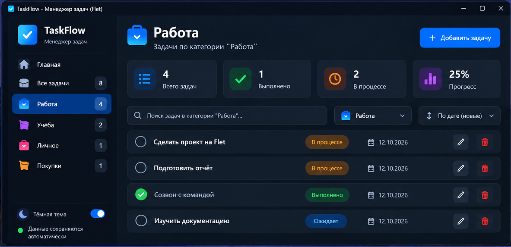
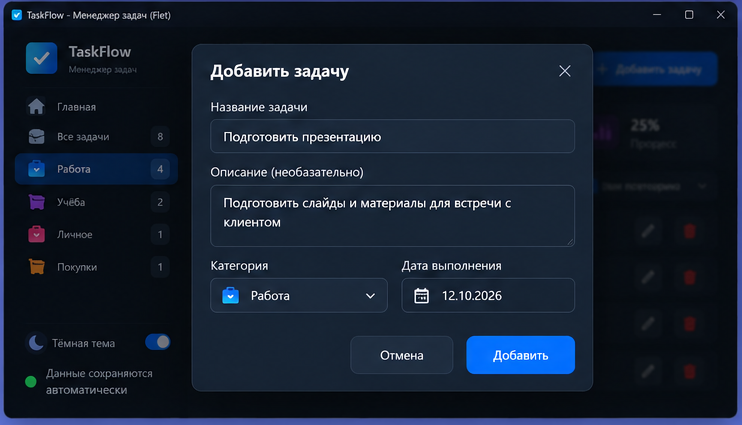
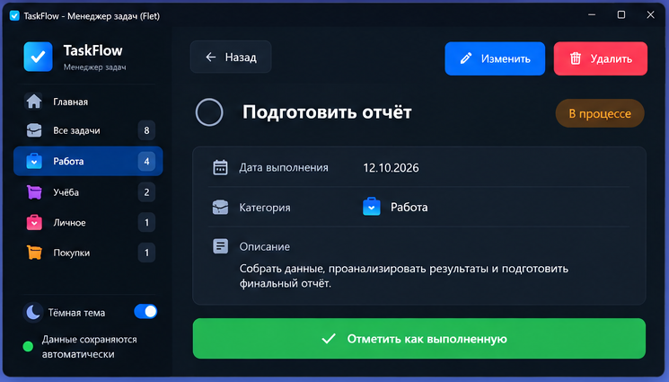
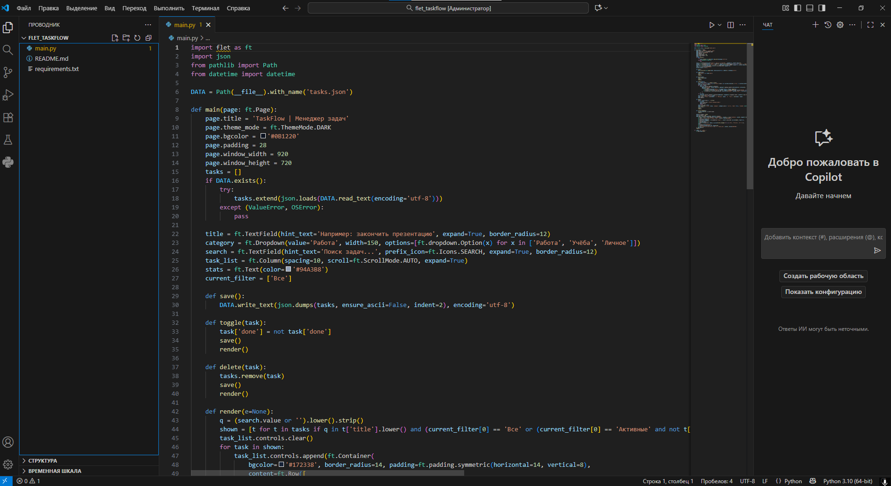

# TaskFlow — готовый проект на Flet

Современный менеджер задач на Python + Flet с тёмной темой.

## Возможности
- Добавление и удаление задач
- Отметка выполненных задач
- Категории: Работа, Учёба, Личное
- Поиск и фильтрация
- Автосохранение задач в JSON
- Русскоязычный интерфейс

## Запуск
1. Установите Python 3.10 или новее.
2. Откройте терминал в папке проекта.
3. Установите зависимости: `pip install -r requirements.txt`
4. Запустите приложение: `python main.py`

Файл `tasks.json` создаётся автоматически после первого изменения задач.

## Изображения проекта

Три изображения интерфейса — демонстрационные макеты с датой 12.10.2026.
Они могут отличаться от интерфейса запущенного приложения.
Четвёртое изображение — предоставленный скриншот исходного кода в VS Code.

### Раздел «Работа»

### Добавление задачи

### Отчёт

### Код в VS Code

## Размещение на GitHub

1. Распакуйте архив.
2. Создайте репозиторий `TaskFlow` на GitHub.
3. Загрузите содержимое папки `flet_taskflow`: `main.py`, `requirements.txt`,
   `README.md`, `.gitignore` и папку `screenshots` со всеми изображениями.
4. Сохраните загрузку коммитом. Изображения будут показаны в README.

Загружайте распакованные файлы, чтобы исходный код и README можно было просматривать
прямо в репозитории. Локальный файл `tasks.json` с личными задачами загружать не нужно.
